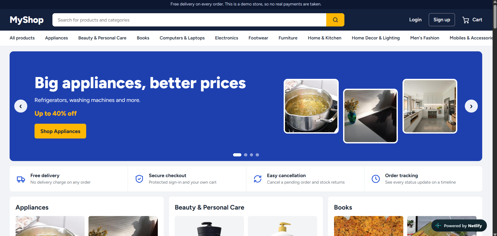
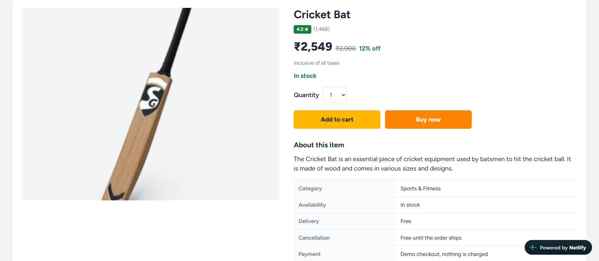
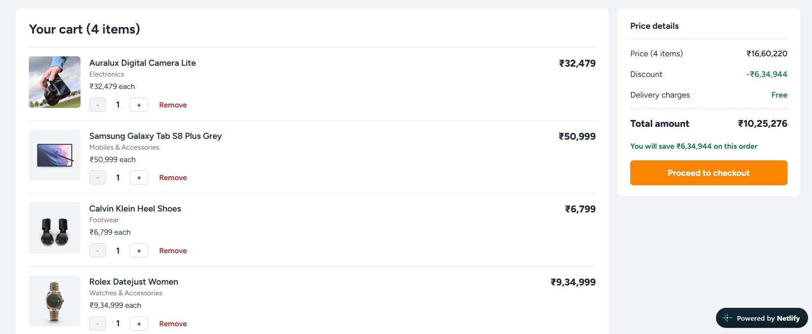
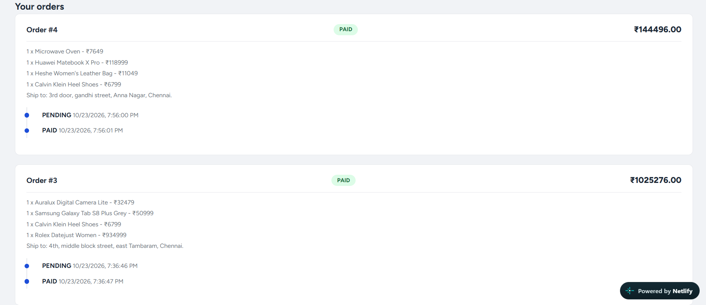

# MyShop - Full-Stack E-Commerce Store

A full-stack online store with 800+ products in 15 categories. Customers can browse, search, add items to a cart, check out and track their orders. Built with React, Django REST Framework and MySQL, and deployed on free cloud services.

**Live demo:** https://heartfelt-stardust-98df92.netlify.app
**Source code:** https://github.com/Avinesh354/E_commerce-store

## Features

- Amazon and Flipkart style home page: rotating banner, deal cards and scrolling product rows
- Search, category filters, sorting and pagination
- Product pages with related products
- Register and login with JWT authentication
- Cart with stock checks, checkout, and order history with a status timeline
- Cancel a pending order and the stock returns
- Admin panel to manage products and order status

## Engineering highlights

- **Stock-safe checkout:** orders are created inside a database transaction with row locking, so two buyers can never take the last item.
- **JWT with silent refresh:** an Axios interceptor adds the token to every request and refreshes it when it expires.
- **Instant pages on free hosting:** free servers sleep when idle, so the product list is saved inside the website as `catalog.json`. Browsing is instant, and the server wakes quietly in the background for login and cart.
- **Tested:** 10 pytest tests cover login, cart limits, overselling, cancelling and order privacy.

## Tech stack

| Layer | Technology |
|---|---|
| Frontend | React (Vite), React Router, Axios |
| Backend | Python, Django, Django REST Framework, SimpleJWT |
| Database | MySQL |
| Testing | pytest |
| Hosting | Netlify (frontend), Render (backend), Aiven (database) |

## Architecture

    React (Netlify)  ->  Django REST API (Render)  ->  MySQL (Aiven)

## Run locally

Backend:

    cd backend/E_commerce
    python -m venv .venv
    .venv\Scripts\activate
    python -m pip install -r requirements.txt
    python manage.py migrate
    python manage.py seed_products --reset
    python manage.py import_dummyjson
    python manage.py runserver

Create a `.env` file next to `manage.py` with `SECRET_KEY`, `DEBUG=True`, `DB_NAME`, `DB_USER` and `DB_PASSWORD`.

Frontend:

    cd frontend
    npm install
    npm run dev

Tests: `python -m pytest` inside `backend/E_commerce`.

## Notes

- Checkout is a demo. No real payments are taken.
- Ratings, reviews and discounts are sample data. Product photos come from DummyJSON and Pixabay.
- The backend runs on a free server, so login and cart can take up to a minute the first time it wakes.
